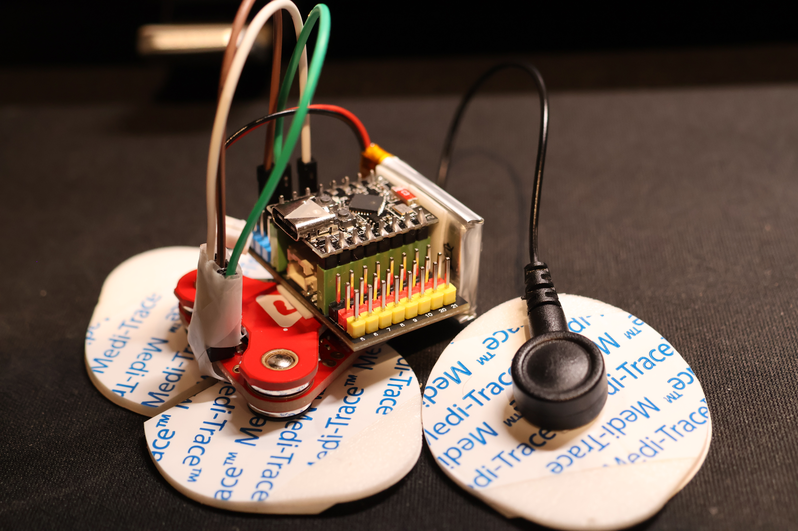
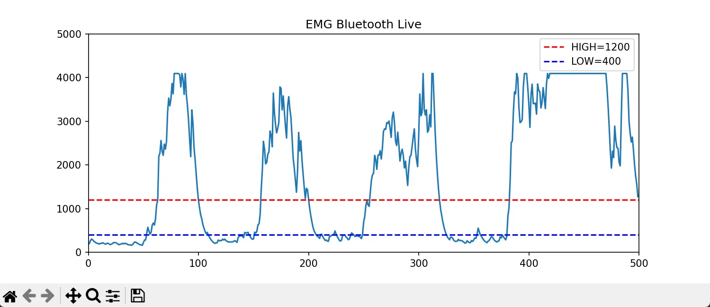

[English](README.md) | [中文(决策解释)](README.zh.md)

# EMG Wireless Controller

A wireless EMG wearable that reads muscle signals from the arm or face over Bluetooth and maps them to computer input. Built from scratch for ~$60.

## Demo

https://github.com/user-attachments/assets/9c49c8d5-d93e-4a0d-b162-bd83cf054689

## What It Does

MyoWare 2.0 reads surface EMG signals from the arm or face, an ESP32-C3 SuperMini digitizes and broadcasts the data over BLE, and a Python script on the computer receives the signal in real time to control simple binary functions — pressing space to play Flappy Bird, triggering jumps in Geometry Dash, or switching songs with a jaw clench.

## Hardware



| Component | Model | Purpose | ~Price |
|-----------|-------|---------|--------|
| EMG Sensor | MyoWare 2.0 | Amplification + envelope extraction | $43 |
| Microcontroller | ESP32-C3 SuperMini (FancyWhoop) | ADC + BLE transmission | $4 |
| Expansion Board | AITRIP SuperMini Expansion | Battery charging + GPIO breakout | $5 |
| Battery | 3.7V 380mAh LiPo (PH2.0) | Wireless power | $7 |
| Electrodes | Medi-Trace ECG (snap) | Signal pickup | ~$1/each |

## Signal Chain
````
Muscle contraction
  → Surface electrodes (pick up µV-level signal)
    → MyoWare 2.0 (amplify + filter + rectify → ENV envelope output)
      → ESP32-C3 SuperMini ADC (analog → 12-bit digital, 0–4095)
        → BLE broadcast
          → Python (bleak) receives on computer
            → Threshold detection → keystroke (pynput)
````

MyoWare handles the analog front-end (bandpass filtering, rectification, envelope extraction) in hardware. The ESP32 only needs to sample the clean ENV output and transmit it — no DSP required on the microcontroller.

## Technical Decisions

**Soldering & mechanical connection** — I soldered a 3-pin header onto MyoWare for the first time, but the pins were too short for the jumper cables to grip securely. Since desoldering the header would risk damaging the board, I taped the cables to the pins as a temporary fix. Lesson: for wearable builds where connections will be moved and stressed, soldering wires directly to pads is more reliable than pin headers with jumper cables. 

**Swapped GND and 3.3V** — During testing on the SuperMini, the signal flatlined and MyoWare's green activity LED stayed on regardless of muscle contraction. After checking every GPIO pin and ruling out code issues, I discovered the 3.3V and GND jumper cables were swapped. Fixing the polarity immediately restored normal operation. This was hard to catch because MyoWare still powered on (red LED lit) with reversed polarity — it just couldn't amplify properly. 

**3.3V supply instead of 5V** — When migrating from Arduino Uno (5V system) to the ESP32-C3 SuperMini (3.3V system), I switched MyoWare's supply from 5V to 3.3V. MyoWare's operating range is 3.3–5V so it works at either voltage, but the ESP32-C3's ADC pins cannot tolerate inputs above 3.3V. Supplying MyoWare at 3.3V keeps its ENV output within the ADC's safe range. 

**DFU driver missing on Windows** — The first attempt to flash the Arduino Nano ESP32 failed with "No DFU capable USB device available." The board entered DFU mode (visible in Device Manager with a yellow warning icon), but Windows had no driver for it. Installing WinUSB via Zadig for the "Arduino DFU" device resolved the issue permanently. 

**pynput over pyautogui/keyboard** — My initial Python code used pyautogui and the keyboard library to simulate keystrokes. This worked in text editors but failed silently in games like Celeste — the game received no input. Switching to pynput solved it, likely because pynput injects input at a lower OS level. This was confirmed by a prior course project (ELEC 220) where pynput successfully controlled the same game. 

**Dual-threshold hysteresis** — A single threshold caused rapid false triggering when the EMG signal hovered near the boundary — especially during sustained grip, where muscle fatigue gradually pulls the signal down into the threshold zone. Adding separate HIGH (1200) and LOW (500) thresholds creates a dead zone: the signal must rise above HIGH to trigger, then fall below LOW before it can trigger again. This eliminated oscillation artifacts entirely. 

**Peak-relative dropout** — Even with hysteresis, fast repeated clenches were missed because the ENV envelope couldn't decay to the absolute LOW threshold before the next contraction began. I replaced the fixed LOW threshold with a relative criterion: a new trigger is allowed once the signal drops to 60% of the most recent peak. This adapts automatically to signal amplitude (works for both strong forearm signals and weaker facial signals) and significantly improved responsiveness during rapid inputs, though it still cannot match finger speed.

## Iteration History

1. **Arduino Uno + USB serial** — Validated the basic signal chain: MyoWare ENV → analogRead → Serial Plotter. First time seeing my own EMG signal. [emg_serial_basic.ino](https://github.com/BrianYuyuan/emg-wireless-controller/blob/main/arduino/emg_serial_basic.ino)
2. **Edge detection + hysteresis** — Added threshold-based triggering in Python. Controlled Flappy Bird (single clench = flap), then Celeste (short clench = jump, sustained clench = walk). [emg_serial_game.py](https://github.com/BrianYuyuan/emg-wireless-controller/blob/main/python/emg_serial_game.py)
3. **Dual-threshold hysteresis** — Solved the oscillation problem where muscle fatigue during sustained grip caused the signal to hover near the threshold.
4. **Peak-relative dropout** — Solved the high-frequency re-triggering problem where the ENV envelope couldn't decay fast enough between rapid clenches.
5. **Arduino Nano ESP32 + BLE** — Migrated from USB serial to Bluetooth. Validated wireless signal transmission with the same Python processing pipeline. 
6. **ESP32-C3 SuperMini + expansion board + LiPo battery** — Fully wireless, battery-powered. Eliminated all physical connection to the computer. [emg_ble_server.ino](https://github.com/BrianYuyuan/emg-wireless-controller/blob/main/arduino/emg_ble_server.ino)
7. **Facial EMG validation** — Tested jaw clench (temporalis muscle) with wet electrodes. Signal is weaker than forearm (peak ~500 vs ~4000) but clearly detectable with adjusted thresholds. [emg_ble_receive.py](https://github.com/BrianYuyuan/emg-wireless-controller/blob/main/python/emg_ble_receive.py)

## Results

### Forearm EMG — Wired (Arduino Uno)


Baseline ~100, clench peaks reaching 900+. Clean separation, high SNR.

### Forearm EMG — Wireless (SuperMini + BLE + Battery)


Baseline ~200–300, clench peaks reaching 3500–4100 (12-bit ADC). No degradation from wireless transmission. Battery-powered signal is actually cleaner than wall-powered (no mains noise coupling).

## Limitations

- **Single channel = single bit.** One EMG channel can only distinguish "active vs. not active." This limits control to simple binary commands — no proportional control, no multi-gesture vocabulary.
- **Muscle speed ceiling.** Human muscle contraction-relaxation cycle is 100–200ms minimum. Combined with BLE latency (~50ms) and ENV envelope decay, the effective input rate caps around 3–4 commands/second — fast enough for Flappy Bird, too slow for rhythm games.
- **Electrode contact fragility.** Wet adhesive electrodes work well but are single-use. Dry electrode contact on facial skin (tested with bare metal snaps) was highly unstable — mechanical contact pressure is the dominant variable, not signal processing.
- **matplotlib blocks asyncio.** Real-time plotting in the same process as BLE reception introduces visible input latency. Separating visualization into a different process would solve this but adds complexity.

## Next Steps

- **Dry electrode feasibility** — Test conductive foam/rubber electrodes with a headband for stable dry contact on the temporalis, comparing signal quality against wet electrode baseline.
- **BLE HID (keyboard emulation)** — Move threshold detection onto the ESP32 itself so it acts as a Bluetooth keyboard. Eliminates the need for any computer-side software — phone/tablet/computer just sees a BLE keyboard.
- **Multi-channel + signal weighting** — Add a second electrode site (e.g., opposite jaw, different facial muscle) to expand the command vocabulary beyond one bit. (Reference patent: US20230225659A1)
- **Headphone integration** — Embed electrodes in headphone cushion foam for a wearable that detects jaw clenching (song control, bruxism detection) without visible electrodes.

## Built With

- [MyoWare 2.0](https://www.sparkfun.com/products/21265) — EMG analog front-end
- [ESP32-C3 SuperMini](https://www.espboards.dev/esp32/esp32-c3-super-mini/) — BLE-capable microcontroller
- [bleak](https://github.com/hbldh/bleak) — Python BLE library
- [pynput](https://github.com/moses-palmer/pynput) — Python keyboard control
- Arduino IDE / Arduino Cloud Editor
