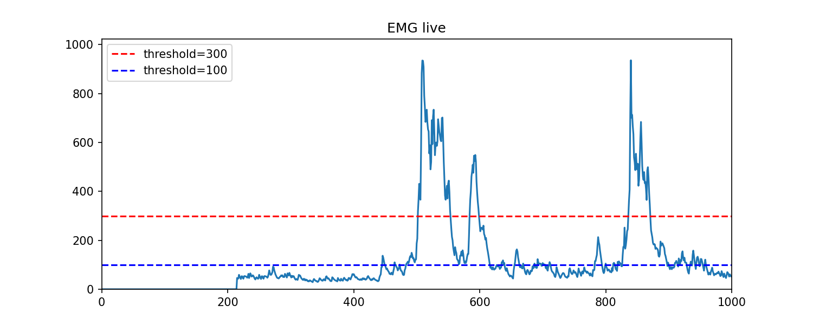

# EMG Wireless Controller

A wireless EMG wearable that reads muscle signals from the arm or face over Bluetooth and maps them to computer input. Built from scratch for ~$30.

## Demo

https://github.com/user-attachments/assets/9c49c8d5-d93e-4a0d-b162-bd83cf054689

## What It Does

MyoWare 2.0 reads surface EMG signals from the arm or face, an ESP32-C3 SuperMini digitizes and broadcasts the data over BLE, and a Python script on the computer receives the signal in real time to control simple binary functions — pressing space to play Flappy Bird, triggering jumps in Geometry Dash, or switching songs with a jaw clench.

## Hardware


| Component | Model | Purpose | ~Price |
|-----------|-------|---------|--------|
| EMG Sensor | MyoWare 2.0 | Amplification + envelope extraction | $43 |
| Microcontroller | ESP32-C3 SuperMini (FancyWhoop) | ADC + BLE transmission | $4 |
| Expansion Board | AITRIP SuperMini Expansion | Battery charging + GPIO breakout | $5 |
| Battery | 3.7V 380mAh LiPo (PH2.0) | Wireless power | $7 |
| Electrodes | Medi-Trace ECG (snap) | Signal pickup | ~$1/each |

## Signal Chain
````
Muscle contraction
  → Surface electrodes (pick up µV-level signal)
    → MyoWare 2.0 (amplify + filter + rectify → ENV envelope output)
      → ESP32-C3 SuperMini ADC (analog → 12-bit digital, 0–4095)
        → BLE broadcast
          → Python (bleak) receives on computer
            → Threshold detection → keystroke (pynput)
````

MyoWare handles the analog front-end (bandpass filtering, rectification, envelope extraction) in hardware. The ESP32 only needs to sample the clean ENV output and transmit it — no DSP required on the microcontroller.

## Key Technical Decisions

**Dual-threshold hysteresis** — A single threshold causes rapid toggling when the signal hovers near the boundary (especially during sustained grip as muscle fatigue pulls the signal down). Using separate HIGH (1200) and LOW (500) thresholds creates a dead zone that eliminates false triggers.

**Peak-relative dropout** — For fast repeated activations, waiting for the signal to drop to an absolute LOW threshold is too slow (the ENV envelope has a hardware time constant). Instead, a new activation is allowed once the signal drops to 60% of the most recent peak, enabling faster re-triggering without waiting for full baseline recovery.

**3.3V supply path** — MyoWare supports 3.3–5V input. The ESP32-C3 is a 3.3V system; supplying MyoWare from the 3V3 pin keeps ENV output within the ADC's safe input range. Using 5V would risk damaging the GPIO.

**pynput over pyautogui/keyboard** — pyautogui and the keyboard library failed to inject keystrokes into certain games (Celeste, Geometry Dash) due to Windows input-layer restrictions. pynput's lower-level approach worked reliably, confirmed by a prior ELEC220 project using the same library for game control.

**BLE notify model** — The ESP32 pushes each ADC sample via BLE notifications rather than requiring the computer to poll. Python receives samples asynchronously through bleak callbacks, keeping latency minimal.

## Iteration History

1. **Arduino Uno + USB serial** — Validated the basic signal chain: MyoWare ENV → analogRead → Serial Plotter. First time seeing my own EMG signal.
2. **Edge detection + hysteresis** — Added threshold-based triggering in Python. Controlled Flappy Bird (single clench = flap), then Celeste (short clench = jump, sustained clench = walk).
3. **Dual-threshold hysteresis** — Solved the oscillation problem where muscle fatigue during sustained grip caused the signal to hover near the threshold.
4. **Peak-relative dropout** — Solved the high-frequency re-triggering problem where the ENV envelope couldn't decay fast enough between rapid clenches.
5. **Arduino Nano ESP32 + BLE** — Migrated from USB serial to Bluetooth. Validated wireless signal transmission with the same Python processing pipeline.
6. **ESP32-C3 SuperMini + expansion board + LiPo battery** — Fully wireless, battery-powered. Eliminated all physical connection to the computer.
7. **Facial EMG validation** — Tested jaw clench (temporalis muscle) with wet electrodes. Signal is weaker than forearm (peak ~500 vs ~4000) but clearly detectable with adjusted thresholds.

## Results

### Forearm EMG — Wired (Arduino Uno)


Baseline ~100, clench peaks reaching 900+. Clean separation, high SNR.

### Forearm EMG — Wireless (SuperMini + BLE + Battery)


Baseline ~200–300, clench peaks reaching 3500–4100 (12-bit ADC). No degradation from wireless transmission. Battery-powered signal is actually cleaner than wall-powered (no mains noise coupling).

## Limitations

- **Single channel = single bit.** One EMG channel can only distinguish "active vs. not active." This limits control to simple binary commands — no proportional control, no multi-gesture vocabulary.
- **Muscle speed ceiling.** Human muscle contraction-relaxation cycle is 100–200ms minimum. Combined with BLE latency (~50ms) and ENV envelope decay, the effective input rate caps around 3–4 commands/second — fast enough for Flappy Bird, too slow for rhythm games.
- **Electrode contact fragility.** Wet adhesive electrodes work well but are single-use. Dry electrode contact on facial skin (tested with bare metal snaps) was highly unstable — mechanical contact pressure is the dominant variable, not signal processing.
- **matplotlib blocks asyncio.** Real-time plotting in the same process as BLE reception introduces visible input latency. Separating visualization into a different process would solve this but adds complexity.

## Next Steps

- **Dry electrode feasibility** — Test conductive foam/rubber electrodes with a headband for stable dry contact on the temporalis, comparing signal quality against wet electrode baseline.
- **BLE HID (keyboard emulation)** — Move threshold detection onto the ESP32 itself so it acts as a Bluetooth keyboard. Eliminates the need for any computer-side software — phone/tablet/computer just sees a BLE keyboard.
- **Multi-channel EMG** — Add a second electrode site (e.g., opposite jaw, different facial muscle) to expand the command vocabulary beyond one bit.
- **Headphone integration** — Embed electrodes in headphone cushion foam for a wearable that detects jaw clenching (song control, bruxism detection) without visible electrodes.

## Built With

- [MyoWare 2.0](https://www.sparkfun.com/products/21265) — EMG analog front-end
- [ESP32-C3 SuperMini](https://www.espboards.dev/esp32/esp32-c3-super-mini/) — BLE-capable microcontroller
- [bleak](https://github.com/hbldh/bleak) — Python BLE library
- [pynput](https://github.com/moses-palmer/pynput) — Python keyboard control
- Arduino IDE / Arduino Cloud Editor
